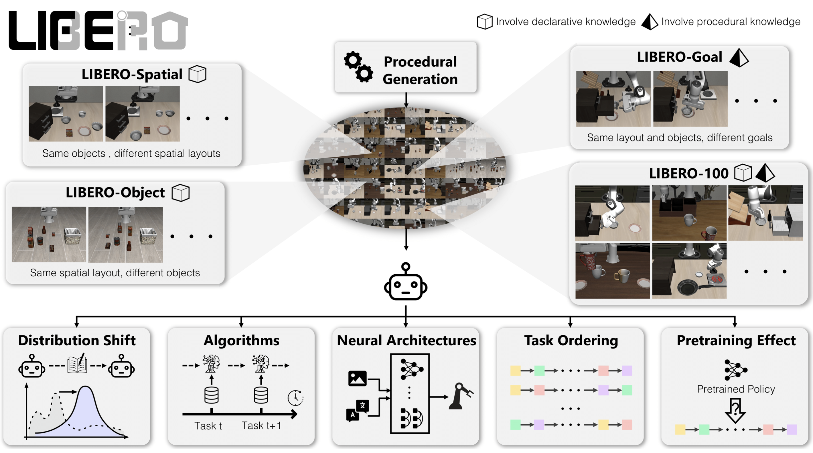

<div align="center">


<p align="center">
<a href="https://github.com/Lifelong-Robot-Learning/LIBERO/actions">

</a>
<a href="https://github.com/Lifelong-Robot-Learning/LIBERO/graphs/contributors">

</a>
<a href="https://github.com/Lifelong-Robot-Learning/LIBERO/issues">


## **Benchmarking Knowledge Transfer for Lifelong Robot Learning**

Bo Liu, Yifeng Zhu, Chongkai Gao, Yihao Feng, Qiang Liu, Yuke Zhu, Peter Stone

[[Website]](https://libero-project.github.io)
[[Paper]](https://arxiv.org/pdf/2306.03310.pdf)
[[Docs]](https://lifelong-robot-learning.github.io/LIBERO/)
______________________________________________________________________

</div>

**LIBERO** is designed for studying knowledge transfer in multitask and lifelong robot learning problems. Successfully resolving these problems require both declarative knowledge about objects/spatial relationships and procedural knowledge about motion/behaviors. **LIBERO** provides:
- a procedural generation pipeline that could in principle generate an infinite number of manipulation tasks.
- 130 tasks grouped into four task suites: **LIBERO-Spatial**, **LIBERO-Object**, **LIBERO-Goal**, and **LIBERO-100**. The first three task suites have controlled distribution shifts, meaning that they require the transfer of a specific type of knowledge. In contrast, **LIBERO-100** consists of 100 manipulation tasks that require the transfer of entangled knowledge. **LIBERO-100** is further splitted into **LIBERO-90** for pretraining a policy and **LIBERO-10** for testing the agent's downstream lifelong learning performance.
- five research topics.
- three visuomotor policy network architectures.
- three lifelong learning algorithms with the sequential finetuning and multitask learning baselines.

---


# Contents

- [Installation](#Installation)
- [Datasets](#Dataset)
- [Getting Started](#Getting-Started)
  - [Task](#Task)
  - [Training](#Training)
  - [Evaluation](#Evaluation)
- [Citation](#Citation)
- [License](#License)


# Installtion
Please run the following commands in the given order to install the dependency for **LIBERO**.
```
conda create -n libero python=3.8.13
conda activate libero
git clone https://github.com/Lifelong-Robot-Learning/LIBERO.git
cd LIBERO
pip install -r requirements.txt
pip install torch==1.11.0+cu113 torchvision==0.12.0+cu113 torchaudio==0.11.0 --extra-index-url https://download.pytorch.org/whl/cu113
```

Then install the `libero` package:
```
pip install -e .
```

# Datasets
We provide high-quality human teleoperation demonstrations for the four task suites in **LIBERO**. To download the demonstration dataset, run:
```python
python benchmark_scripts/download_libero_datasets.py
```
By default, the dataset will be stored under the ```LIBERO``` folder and all four datasets will be downloaded. To download a specific dataset, use
```python
python benchmark_scripts/download_libero_datasets.py --datasets DATASET
```
where ```DATASET``` is chosen from `[libero_spatial, libero_object, libero_100, libero_goal`.

**NEW!!!**

Alternatively, you can download the dataset from HuggingFace by using:
```python
python benchmark_scripts/download_libero_datasets.py --use-huggingface
```

This option can also be combined with the specific dataset selection:
```python
python benchmark_scripts/download_libero_datasets.py --datasets DATASET --use-huggingface
```

The datasets hosted on HuggingFace are available at [here](https://huggingface.co/datasets/yifengzhu-hf/LIBERO-datasets).


# Getting Started

For a detailed walk-through, please either refer to the documentation or the notebook examples provided under the `notebooks` folder. In the following, we provide example scripts for retrieving a task, training and evaluation.

## Task

The following is a minimal example of retrieving a specific task from a specific task suite.
```python
from libero.libero import benchmark
from libero.libero.envs import OffScreenRenderEnv


benchmark_dict = benchmark.get_benchmark_dict()
task_suite_name = "libero_10" # can also choose libero_spatial, libero_object, etc.
task_suite = benchmark_dict[task_suite_name]()

# retrieve a specific task
task_id = 0
task = task_suite.get_task(task_id)
task_name = task.name
task_description = task.language
task_bddl_file = os.path.join(get_libero_path("bddl_files"), task.problem_folder, task.bddl_file)
print(f"[info] retrieving task {task_id} from suite {task_suite_name}, the " + \
      f"language instruction is {task_description}, and the bddl file is {task_bddl_file}")

# step over the environment
env_args = {
    "bddl_file_name": task_bddl_file,
    "camera_heights": 128,
    "camera_widths": 128
}
env = OffScreenRenderEnv(**env_args)
env.seed(0)
env.reset()
init_states = task_suite.get_task_init_states(task_id) # for benchmarking purpose, we fix the a set of initial states
init_state_id = 0
env.set_init_state(init_states[init_state_id])

dummy_action = [0.] * 7
for step in range(10):
    obs, reward, done, info = env.step(dummy_action)
env.close()
```
Currently, we only support sparse reward function (i.e., the agent receives `+1` when the task is finished). As sparse-reward RL is extremely hard to learn, currently we mainly focus on lifelong imitation learning.

## Training
To start a lifelong learning experiment, please choose:
- `BENCHMARK` from `[LIBERO_SPATIAL, LIBERO_OBJECT, LIBERO_GOAL, LIBERO_90, LIBERO_10]`
- `POLICY` from `[bc_rnn_policy, bc_transformer_policy, bc_vilt_policy]`
- `ALGO` from `[base, er, ewc, packnet, multitask]`

then run the following:

```shell
export CUDA_VISIBLE_DEVICES=GPU_ID && \
export MUJOCO_EGL_DEVICE_ID=GPU_ID && \
python libero/lifelong/main.py seed=SEED \
                               benchmark_name=BENCHMARK \
                               policy=POLICY \
                               lifelong=ALGO
```
Please see the documentation for the details of reproducing the study results.

## Evaluation

By default the policies will be evaluated on the fly during training. If you have limited computing resource of GPUs, we offer an evaluation script for you to evaluate models separately.

```shell
python libero/lifelong/evaluate.py --benchmark BENCHMARK_NAME \
                                   --task_id TASK_ID \ 
                                   --algo ALGO_NAME \
                                   --policy POLICY_NAME \
                                   --seed SEED \
                                   --ep EPOCH \
                                   --load_task LOAD_TASK \
                                   --device_id CUDA_ID
```

# Citation
If you find **LIBERO** to be useful in your own research, please consider citing our paper:

```bibtex
@article{liu2023libero,
  title={LIBERO: Benchmarking Knowledge Transfer for Lifelong Robot Learning},
  author={Liu, Bo and Zhu, Yifeng and Gao, Chongkai and Feng, Yihao and Liu, Qiang and Zhu, Yuke and Stone, Peter},
  journal={arXiv preprint arXiv:2306.03310},
  year={2023}
}
```

# License
| Component        | License                                                                                                                             |
|------------------|-------------------------------------------------------------------------------------------------------------------------------------|
| Codebase         | [MIT License](LICENSE)                                                                                                                      |
| Datasets         | [Creative Commons Attribution 4.0 International (CC BY 4.0)](https://creativecommons.org/licenses/by/4.0/legalcode)                 |

# Dataset
key list:
📊 data/demo_0/actions
📊 data/demo_0/dones
📊 data/demo_0/obs/agentview_rgb
📊 data/demo_0/obs/ee_ori
📊 data/demo_0/obs/ee_pos
📊 data/demo_0/obs/ee_states
📊 data/demo_0/obs/eye_in_hand_rgb
📊 data/demo_0/obs/gripper_states
📊 data/demo_0/obs/joint_states
📊 data/demo_0/rewards
📊 data/demo_0/robot_states
📊 data/demo_0/states
📊 data/demo_1/actions
📊 data/demo_1/dones
📊 data/demo_1/obs/agentview_rgb
📊 data/demo_1/obs/ee_ori
📊 data/demo_1/obs/ee_pos
📊 data/demo_1/obs/ee_states
📊 data/demo_1/obs/eye_in_hand_rgb
📊 data/demo_1/obs/gripper_states
📊 data/demo_1/obs/joint_states
📊 data/demo_1/rewards
📊 data/demo_1/robot_states
📊 data/demo_1/states

detail:
📊 数据集: data/demo_0/actions
  Shape: (148, 7) ✅
  Dtype: float64 ✅
  Data (first 1 elements): [[ 0.24642857 -0.51696429  0.01607143  0.          0.01821429 -0.
  -1.        ]] 📈

📊 指定key对应的数据集: data/demo_0/dones
  Shape: (148,) ✅
  Dtype: uint8 ✅
  Data (first 1 elements): [0] 📈

📊 指定key对应的数据集: data/demo_0/obs/agentview_rgb
  Shape: (148, 128, 128, 3) ✅
  Dtype: uint8 ✅
  Data (first 1 elements): [[[[172 164 159]
   [176 167 163]
   [175 167 160]
   ...
   [199 191 182]
   [198 189 180]
   [199 191 182]]

  [[135 132 128]
   [134 132 128]
   [134 132 128]
   ...
   [138 136 131]
   [138 136 131]
   [138 136 132]]]] 📈

📊 指定key对应的数据集: data/demo_0/obs/ee_ori
  Shape: (148, 3) ✅
  Dtype: float64 ✅
  Data (first 1 elements): [[ 3.13415876 -0.04464834 -0.06500138]]

📊 指定key对应的数据集: data/demo_0/obs/ee_pos
  Shape: (148, 3) ✅
  Dtype: float64 ✅
  Data (first 1 elements): [[-0.13461222 -0.03159367  0.26087246]]

📊 指定key对应的数据集: data/demo_0/obs/ee_states
  Shape: (148, 6) ✅
  Dtype: float64 ✅
  Data (first 1 elements): [[-0.13461222 -0.03159367  0.26087246  3.13415876 -0.04464834 -0.06500138]] 📈

📊 指定key对应的数据集: data/demo_0/obs/eye_in_hand_rgb
  Shape: (148, 128, 128, 3) ✅
  Dtype: uint8 ✅
  Data (first 1 elements): [[[[ 57  57  57]
   [ 57  57  57]
   [ 57  57  57]
   ...
   [ 56  56  56]
   [ 56  56  56]
   [ 56  56  56]]

  [[192 182 172]
   [195 185 175]
   [203 193 183]
   ...
   [102  63  55]
   [103  85  82]
   [103  86  84]]]] 📈

📊 指定key对应的数据集: data/demo_0/obs/gripper_states
  Shape: (148, 2) ✅
  Dtype: float64 ✅
  Data (first 1 elements): [[ 0.03610362 -0.03629859]] 📈

📊 指定key对应的数据集: data/demo_0/obs/joint_states
  Shape: (148, 7) ✅
  Dtype: float64 ✅
  Data (first 1 elements): [[-0.01647415 -0.12439009 -0.04895048 -2.40863181 -0.01870208  2.24320355
   0.7614374 ]] 📈

📊 指定key对应的数据集: data/demo_0/rewards
  Shape: (148,) ✅
  Dtype: uint8 ✅
  Data (first 1 elements): [0] 📈

只有抓到时会奖励：
📊 指定key对应的数据集: data/demo_0/rewards
  Shape: (148,) ✅
  Dtype: uint8 ✅
  Data (first 1 elements): [0 0 0 0 0 0 0 0 0 0 0 0 0 0 0 0 0 0 0 0 0 0 0 0 0 0 0 0 0 0 0 0 0 0 0 0 0
 0 0 0 0 0 0 0 0 0 0 0 0 0 0 0 0 0 0 0 0 0 0 0 0 0 0 0 0 0 0 0 0 0 0 0 0 0
 0 0 0 0 0 0 0 0 0 0 0 0 0 0 0 0 0 0 0 0 0 0 0 0 0 0 0 0 0 0 0 0 0 0 0 0 0
 0 0 0 0 0 0 0 0 0 0 0 0 0 0 0 0 0 0 0 0 0 0 0 0 0 0 0 0 0 0 0 0 0 0 0 0 1] 📈

📊 指定key对应的数据集: data/demo_0/robot_states
  Shape: (148, 9) ✅
  Dtype: float64 ✅
  Data (first 1 elements): [[ 0.03610362 -0.03629859 -0.13461222 -0.03159367  0.26087246  0.99967843
  -0.01424114 -0.02073299  0.00322098]] 📈

0.99967843 -0.01424114 -0.02073299  0.00322098 ❗不清楚对应的是哪里

📊 指定key对应的数据集: data/demo_0/states
  Shape: (148, 110) ✅
  Dtype: float64 ✅
  Data (first 1 elements): [[ 2.50000000e-01 -1.39058727e-02 -1.32895206e-01 -3.95190726e-02
  -2.41748166e+00 -1.56499662e-02  2.24342081e+00  7.70441485e-01
   3.39412254e-02 -3.41246158e-02 -1.19341153e-01 -2.39844686e-01
   3.83793457e-02 -2.26022130e-03  2.27541573e-03  7.07695320e-01
   7.06510473e-01 -1.43712746e-02  2.45927217e-01 -4.58262675e-03
   7.07104752e-01 -1.69384343e-03  1.69371900e-03  7.07104753e-01
   4.99867361e-02 -9.99780001e-02  9.14421729e-02  5.00114670e-01
   4.99884733e-01  5.00043808e-01  4.99956758e-01 -1.51981690e-01
   5.50623211e-02  8.92147605e-03  1.60411515e-10 -3.16300943e-07
  -1.06977855e-06  1.00000000e+00  9.55577769e-02 -1.98123762e-01
   6.69983663e-02  4.99972463e-01  5.00027595e-01  4.99983556e-01
   5.00016384e-01  1.50242278e-01  3.00555488e-02  3.83998685e-02
  -2.29096800e-03  2.29130000e-03  7.07626522e-01  7.06579229e-01
  -1.99379192e-01 -7.87157716e-02  8.69543094e-03  8.87495516e-10
  -4.17292295e-07 -2.42161980e-06  1.00000000e+00 -4.50482326e-02
   1.55016014e-01 -1.65641087e-01  1.61861455e-01 -5.95531864e-02
  -1.20304390e-02 -1.56137187e-01  5.76449863e-02 -5.71816273e-02
  -3.19849468e-05  3.20957564e-06  9.09489769e-04  8.99028765e-05
  -2.15092962e-06 -8.43101306e-04  8.81460714e-11 -7.43320061e-08
   1.86903244e-05 -1.93300596e-08  1.62516811e-05 -8.34625155e-11
  -4.66691074e-05  7.71475538e-05 -9.80411604e-01 -1.91370102e-04
   2.94757962e-06 -3.58290715e-04 -3.41173844e-12 -3.28112589e-12
   9.13729709e-08 -4.48594712e-10  4.05903512e-10  1.04577420e-13
  -8.44980612e-06  5.70231207e-05 -3.45229732e-01 -1.41749996e-04
   1.01964102e-08 -9.34021809e-04  1.53355879e-09  3.00852655e-09
   4.82651896e-08  7.90797893e-08 -4.52425251e-10  4.04379947e-08
  -9.63592933e-11 -1.90983833e-11  3.10686229e-06 -1.10637040e-08
   1.20000589e-08  8.78974798e-12]] 📈